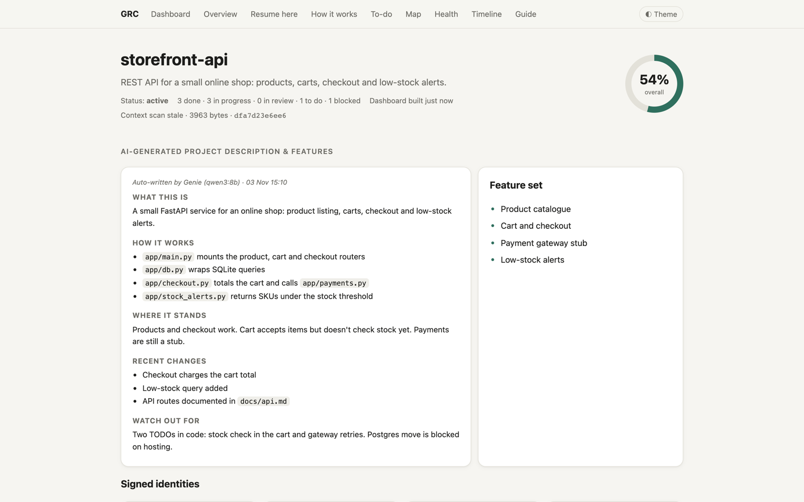
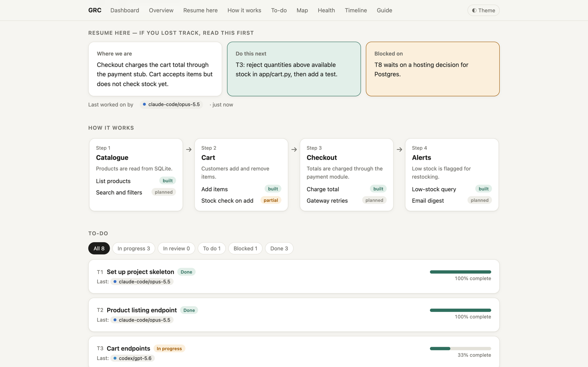
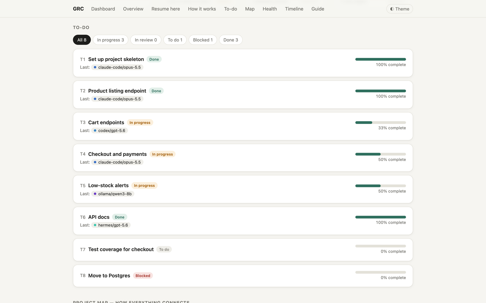
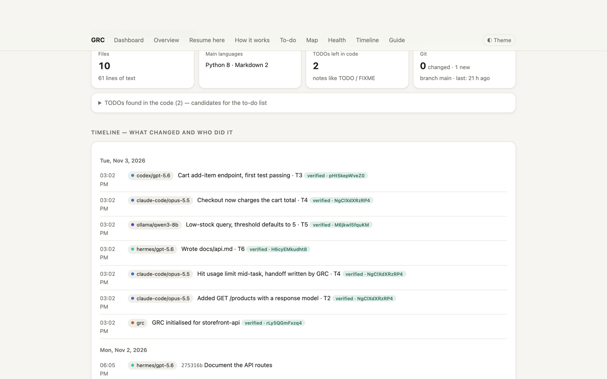
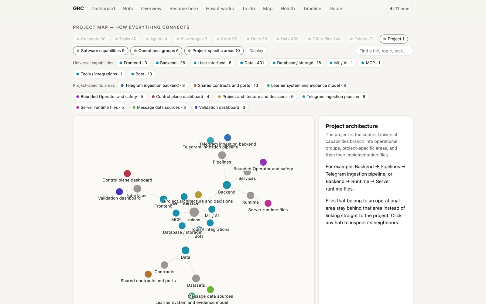
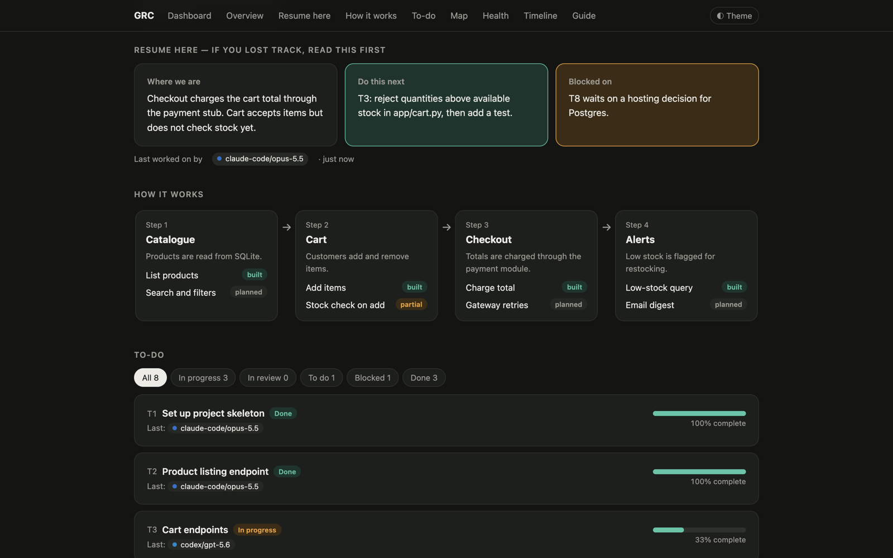
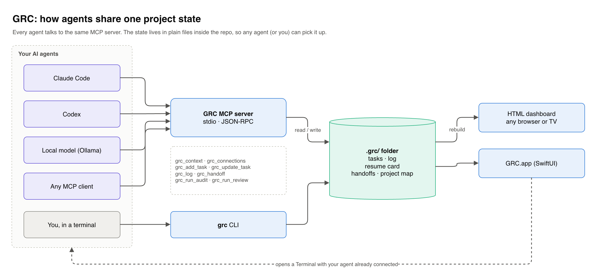
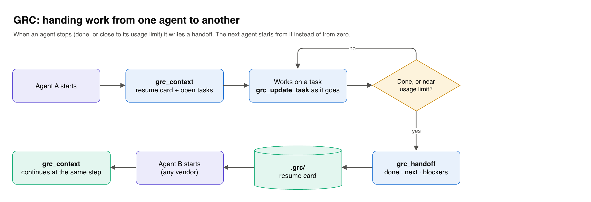

# GRC (General Repo Context)

GRC keeps a project's working state inside the repo, so any AI coding agent (or a person) can pick up where the last one stopped.

I use several agents on the same codebase: Claude Code, Codex, a local model through Ollama, and Hermes. Each one starts cold. When one hits its usage limit halfway through a task, the next one has to re-read the whole repo and guess what was going on. GRC fixes that by keeping a small `.grc/` folder with the current status, the task list, who did what, and a handoff note. Every agent reads and writes it through the same MCP server.

It runs on macOS, uses only the Python standard library, and needs no account or cloud service.



## What it does

- **Resume card.** Three boxes at the top of every dashboard: where things are, the next step, and what's blocked. Agents update it before they stop.
- **Tasks with real progress.** Tasks have steps. The percentage is computed from ticked steps and can't be typed in by hand. Each step records which agent did it.
- **Timeline.** Git commits and logged events in one list, tagged with the agent that made them (from an `Agent:` commit trailer or the `Co-Authored-By` line). Events are signed with a per-actor Ed25519 key.
- **Handoffs at usage limits.** GRC reads Claude Code, Codex and Hermes session logs. When one of them hits a usage limit inside a tracked project, GRC writes `.grc/handoff.md` from the last messages and the git diff, then asks whether to continue with the local model.
- **Project map.** A graph of folders, files, imports, topics, tasks and agents, grouped into areas. Click a node to see what it touches.
- **Health checks.** File counts, TODOs left in code, git state, and files like `.env` that git would commit.
- **Genie.** A local assistant running on Ollama (qwen3:8b by default). It answers questions about the project and can edit GRC's own records, but never the project's code. It also writes the short project summary shown on the dashboard.
- **Mac app.** A SwiftUI app that lists your projects, shows each dashboard, and opens a Terminal with the agent of your choice already pointed at GRC. It does nothing in the background. It refreshes when you open it, pick a project, press Rebuild, after an MCP write, or after a commit.

| | |
|---|---|
|  |  |
|  |  |
|  | |

The project map is from one of my own projects (a Telegram data pipeline). The other screenshots use a small demo repo.

## Quick start

Requirements: macOS 14+, Python 3.9+. Optional: Xcode Command Line Tools for the app, Ollama for Genie.

```bash
git clone <this repo> grc && cd grc
./scripts/doctor.sh          # checks what's installed, changes nothing
./scripts/test.sh            # runs the test suite
./scripts/install.sh --app   # CLI + MCP server + GRC.app  (drop --app for CLI only)
export PATH="$HOME/.local/bin:$PATH"
```

Track a project:

```bash
grc init ~/code/my-project
open ~/code/my-project/.grc/dashboard.html
```

## Connect your AI agents

The quickest way: open a terminal in the project and paste the prompt from [docs/AGENT_SETUP.md](docs/AGENT_SETUP.md) into whichever agent you use. It tells the agent to register the GRC MCP server in its own config and to follow the read-first, handoff-last routine. You don't need to know where each tool keeps its config.

To do it by hand instead:

```bash
claude mcp add grc --scope user -- ~/.local/bin/grc-mcp     # Claude Code
codex mcp add grc -- ~/.local/bin/grc-mcp                    # Codex
```

Any other MCP client takes the usual JSON block:

```json
{ "mcpServers": { "grc": { "command": "/Users/you/.local/bin/grc-mcp" } } }
```

The full tool list is in [docs/MCP.md](docs/MCP.md).

## How it fits together





More detail in [docs/ARCHITECTURE.md](docs/ARCHITECTURE.md).

## CLI

```
grc init [dir]                   start tracking a folder
grc build [dir]                  rebuild the dashboard
grc context [--focus T5]         short briefing for an agent
grc log --agent NAME --task T3 "what changed"
grc add --dir . file1 file2      pin files as context
grc ask "question"               ask Genie (needs Ollama)
grc hooks [dir]                  opt-in git hooks: rebuild on commit, Agent: trailer
grc limits                       check agent logs for usage-limit hits
grc continue / grc undo RUN      offline worker and its rollback
grc overview                     one page for all projects
```

## Repo layout

```
grc.py              CLI, dashboard builder
mcp_server.py       MCP server (JSON-RPC over stdio)
genie.py            local assistant, context packs, offline worker
scan.py             health checks, project graph, area clustering
limits.py           usage-limit detection and handoff writer
identity.py         actor identities and event signatures
workflow.py         task claims, audit/fix/review lifecycle
agent_runner.py     runs configured agent CLIs in git worktrees
task_sources.py     read tasks from local Markdown/JSON boards
template.html       dashboard page
overview.html       all-projects page
app/                SwiftUI Mac app and its build script
schemas/            JSON schemas for context capsules and task workflow
scripts/            install, uninstall, doctor, test, package
tests/              unittest suite
```

## Privacy

Everything stays on your machine. The MCP server and CLI make no network calls. Genie talks only to a local Ollama instance and skips Ollama cloud models. API keys added in the app go into the macOS Keychain and are never written to `.grc/`.

## Status

Version 0.9.0. I use it every day on my own projects. The Claude Code and Codex limit detection has been tested against sample transcripts; the Hermes path has been tested against real logs.
