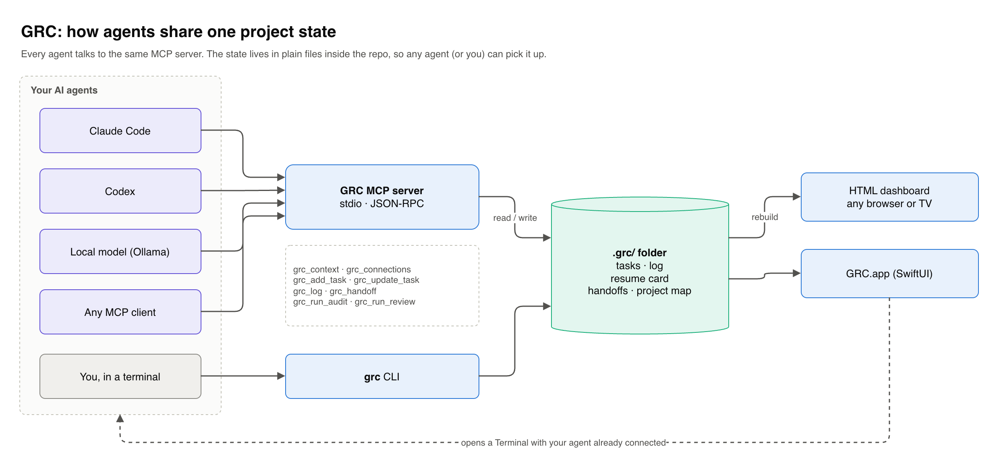

# Architecture



The diagrams in `docs/diagrams/` are draw.io files. Open the `.drawio` versions in [draw.io](https://app.diagrams.net) to edit them.

## Design choices

**State lives in the repo.** Everything GRC knows about a project is in `<project>/.grc/`, as JSON, JSONL and Markdown. You can read it without GRC, diff it, and commit it. Generated files (dashboard, scan results, graph) are git-ignored by `.grc/.gitignore`.

**One interface for every agent.** Agents don't get custom integrations. They all go through the same MCP server, so Claude Code, Codex and a local model see the same tasks and write to the same timeline.

**No background work.** The Mac app doesn't watch files or run timers. Dashboards are rebuilt on specific events: opening the app, selecting a project, pressing Rebuild, an MCP write, or a git commit (if the hooks are installed). Usage-limit checks run when you switch to the app, so the "continue offline?" prompt can show up late. I chose that over keeping the CPU busy.

**Standard library only.** The Python side has no dependencies, so installing it is just copying files. The app is built with `swiftc` from the Command Line Tools. Xcode isn't needed.

## The `.grc/` folder

| File | Contents |
|---|---|
| `project.json` | name, goal, features, flow stages, workflow and runner config |
| `state.json` | the resume card: `now`, `next`, `blocked`, `last_agent`, `updated` |
| `tasks.json` | tasks with steps; each step records the agent that ticked it |
| `events.jsonl` | append-only timeline, each line signed by its actor |
| `actors.json` | public keys for the people and agents that have written events |
| `handoff.md` | latest handoff, from an agent or written by GRC at a usage limit |
| `brief.md` | short project summary written by Genie |
| `clusters.json` | area names for the project map |
| `context/` | files dragged into the app from outside the project |
| `runs/` | records of audit / local / review runs |
| `checkpoints/` | file backups taken by the offline worker, used by `grc undo` |

## Components

```
grc.py ──────── init, build, log, context, hooks, overview
  │
  ├── scan.py ─────── health checks, file/import/topic graph, capability
  │                   detection, area clustering (label propagation)
  ├── genie.py ────── context packs, Genie chat (Ollama tool loop),
  │                   brief writer, offline worker
  ├── limits.py ───── reads agent session logs, detects usage limits,
  │                   writes handoffs
  ├── identity.py ─── Ed25519 actor keys, event signing and verification
  ├── task_sources.py local Markdown/JSON boards as a task source
  └── template.html ─ dashboard, rendered from one embedded JSON blob

mcp_server.py ───── MCP stdio server, calls into grc/genie/workflow
workflow.py ─────── task claims (leases), audit → fix → review states
agent_runner.py ─── runs configured agent CLIs; local work goes in a git worktree
app/GRC.swift ───── SwiftUI shell: sidebar, WKWebView dashboard, Genie panel,
                    agent launcher, connections registry (Keychain for secrets)
```

## Build path

`grc build` does three things:

1. If source files changed since the last scan, `scan.py` rebuilds `scan.json` and `graph.json`. Otherwise the old scan is reused, so a state-only change (ticking a task) rebuilds in milliseconds.
2. Tasks are read from `tasks.json` or from an external source set in `project.json`.
3. Everything is merged into one JSON object and dropped into `template.html`. The dashboard is a single static file you can open straight from disk.

## Usage-limit handoff

```
agent session log ──► limits.py notices a limit message
                          │
                          ├─ inside a registered project?  no → ignore
                          ▼
                 write .grc/handoff.md (last messages + git diff,
                 summarised by Ollama if it's running)
                          │
                          ▼
                 GRC.app asks: continue offline?
                          │ yes
                          ▼
                 genie.py offline worker: small edits only,
                 every file backed up to .grc/checkpoints/<run>
                          │
                          ▼
                 `grc undo <run>` restores the backups
```

Log sources:

- Claude Code: `~/.claude/projects/*/*.jsonl`
- Codex: `~/.codex/sessions/**/*.jsonl`
- Hermes: `~/.hermes/logs/*.log`

Logs are read incrementally and old history is skipped on first sight.

## Audit, fix, review

For projects that set it up, tasks go through a fixed sequence:

1. **Audit.** A stronger model reads the project and records findings. Each finding gets a stable fingerprint, so running the audit twice doesn't create duplicates.
2. **Claim.** One implementer claims the task with a lease. The claim is checked against task dependencies when it's made.
3. **Implement.** The local model works in its own git worktree. The configured tests run afterwards.
4. **Review.** A different agent reviews the exact commit. Only accepted work is merged. If `implementer_may_self_review` is false, the reviewer can't be the implementer.

Abandoned runs release their claims through `grc_recover_runs`.

## Project map

`scan.py` builds a graph with these node types: project, folders, files, concepts (words shared by several files), flow stages, tasks and agents. Edges are `contains`, `imports`, `links_to`, `mentions`, `about`, `worked_on` and `changed`. Files are grouped into areas by label propagation, with direct imports weighted above shared words. Genie can name the areas. You can also write the areas yourself in `clusters.json`, and then those are used as they are.

The dashboard draws the graph on a canvas with a small force simulation. Labels fade in as you zoom.
